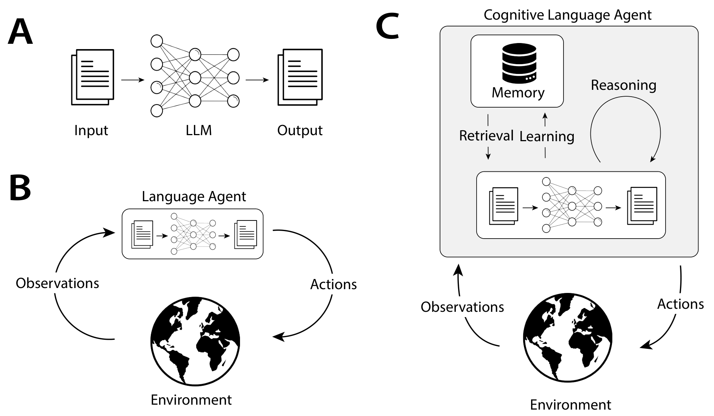
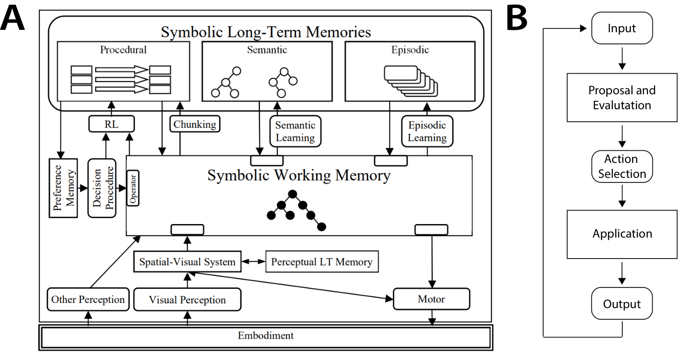
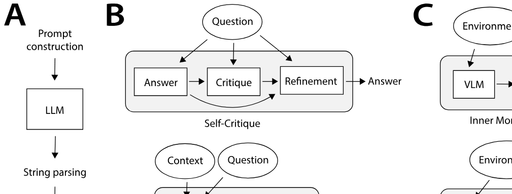
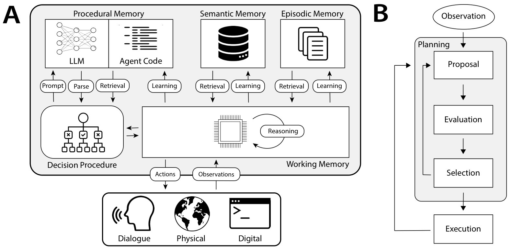
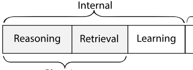

# 语言智能体的认知架构（CoALA）

> **非官方中文翻译，仅供个人学习参考。**
> 原文标题：Cognitive Architectures for Language Agents
> 作者：Theodore R. Sumers、Shunyu Yao、Karthik Narasimhan、Thomas L. Griffiths（普林斯顿大学）
> 发表：Transactions on Machine Learning Research（TMLR），2024 年 2 月；arXiv:2309.02427v3
> 许可：CC BY 4.0
> 翻译日期：2026-11-23
> 说明：按原文正文逐节翻译；原文图 1–5 已按 CC BY 4.0 转载到本地 `assets/coala/` 并嵌入正文；脚注与参考文献未逐条翻译，正文中的作者-年份引用已删除，完整引用见原文参考文献。相关译文：[LangChain《记忆概览》中文版](langchain-memory-zh.md)。

**译者说明**

- 术语采用国内 agent 社区常见译法：language agent = 语言智能体，working memory = 工作记忆，episodic/semantic/procedural memory = 情景/语义/程序记忆，grounding = 落地/接地的外部交互，production system = 产生式系统，cognitive architecture = 认知架构。
- `action` 译为“动作”，`procedure` 译为“过程/程序”，`decision cycle` 译为“决策循环”。
- 为便于阅读，正文中的作者-年份引用已删除；完整引用见原文参考文献。

---

## 摘要

最近的研究通过为大语言模型（LLM）增加外部资源（例如互联网）或内部控制流（例如提示链），来完成需要落地（grounding）或推理的任务，由此产生了一类新的语言智能体。尽管这些智能体已经取得了大量实证成功，我们仍缺乏一个系统框架来组织现有智能体并规划未来发展。本文借鉴认知科学和符号人工智能的丰富历史，提出 **语言智能体的认知架构（Cognitive Architectures for Language Agents，CoALA）**。CoALA 描述了一种语言智能体：它具有模块化的记忆组件、用于与内部记忆和外部环境交互的结构化动作空间，以及选择动作的通用决策过程。我们用 CoALA 回顾性地梳理和组织大量近期工作，并前瞻性地指出构建更强智能体的可行方向。总体而言，CoALA 将当今的语言智能体置于更广阔的 AI 历史中，并勾勒出通向基于语言的一般智能的路径。

---

## 1 引言

语言智能体是一类新兴的人工智能系统：它们使用大语言模型（LLM）与世界交互。它们把 LLM 的最新进展应用到既有的智能体设计领域。有趣的是，这种综合对两个领域都有好处。一方面，LLM 的知识和推理能力有限；语言智能体通过把 LLM 连接到内部记忆和环境，将其落地到已有知识或外部观察上，从而缓解这些问题。另一方面，传统智能体往往需要手工规则或强化学习，难以泛化到新环境；语言智能体利用 LLM 中的常识先验来适应新任务，减少了对人工标注或试错学习的依赖。

最早的智能体直接用 LLM 选择或生成动作（图 1B）。较新的智能体还会用 LLM 进行推理、规划和管理长期记忆，以改进决策。最新一代 **认知语言智能体** 使用了相当复杂的内部过程（图 1C）。然而，目前各个工作使用各自的术语来描述这些过程（例如“工具使用”“落地”“动作”），导致不同智能体难以比较，也难以理解它们如何演化，或如何用干净、一致的抽象来构建新智能体。

为了建立一个组织这些工作的概念框架，我们将其与计算和人工智能（AI）历史上的两个思想联系起来：**产生式系统（production systems）** 和 **认知架构（cognitive architectures）**。产生式系统通过迭代应用规则来生成一组结果。它最初是字符串操作系统——这与 LLM 解决的问题类似——后来被 AI 社区采用，用来定义能够产生复杂、分层行为的系统。为此，产生式系统被纳入认知架构，由认知架构规定选择、应用甚至生成新产生式的控制流。我们认为产生式系统与 LLM 之间存在一个有意义的类比：正如产生式指出修改字符串的可能方式，LLM 定义了在文本上做修改或添加的概率分布。这进一步暗示，用于产生式系统的认知架构控制机制，可能同样适用于把 LLM 变成语言智能体。

因此，我们提出 **语言智能体的认知架构（CoALA）**，一个用于刻画和设计通用语言智能体的概念框架。CoALA 沿三个关键维度组织智能体：

- **信息存储**：分为工作记忆和长期记忆；
- **动作空间**：分为内部动作和外部动作；
- **决策过程**：结构化为一个带规划与执行的交互循环。

通过记忆、动作和决策这三个概念，CoALA 可以简洁地表达大量现有智能体，并识别出尚未充分探索的新智能体方向。值得注意的是，虽然近期已有论文提出面向通用智能的概念架构，或对语言模型和智能体做实证综述，本文结合了两者：我们提出一个理论框架，并用它来组织多样化的实证工作。这使理论扎根于现有实践，也让我们能够识别短期和长期的研究方向。

本文其余部分的安排如下：第 2 节介绍产生式系统和认知架构；第 3 节说明 LLM 和语言智能体如何复现这些历史思想；第 4 节提出 CoALA 框架并用它综述现有语言智能体；第 5 节对几个代表性智能体做更深入的案例研究；第 6 节给出构建未来语言智能体的可操作步骤；第 7 节讨论认知科学与 AI 更宏观的开放问题；第 8 节总结。关注意用智能体设计的读者可以优先阅读第 4–6 节。



*图 1：LLM 的不同用法。A：NLP 中 LLM 接收文本输入并输出文本。B：语言智能体把 LLM 置于与外部环境的直接反馈循环中，把观察转换为文本，并用 LLM 选择动作。C：认知语言智能体还使用 LLM 通过学习和推理等过程管理智能体的内部状态。本文提出一种组织这类智能体的蓝图。*

---

## 2 背景：从字符串到符号 AGI

我们先介绍产生式系统和认知架构，给出认知科学与人工智能的历史视角：从逻辑与计算理论开始，到构建符号通用人工智能的尝试。然后简要介绍语言模型和语言智能体。第 3 节把这些思想连接起来，在产生式系统和语言模型之间建立类比。

### 2.1 用于字符串操作的产生式系统

20 世纪上半叶，一条重要的思想路线把数学和计算归约为符号操作。产生式系统就是其中一种形式化。直观地说，产生式系统由一组规则组成，每条规则指定一个前置条件和一个动作；当前置条件满足时，就可以执行动作。这个思想起源于刻画计算极限的努力。Post 提出用这种方式思考任意逻辑系统：公式表示为字符串，由产生式规则识别其允许的结论（一个字符串“产生”另一个字符串）。这种形式化后来被证明等价于更简单的字符串重写系统。在这种系统中，我们指定如下形式的规则：

```
XYZ → XWZ
```

表示字符串 `XYZ` 可以重写为 `XWZ`。字符串重写在形式语言理论中以 Chomsky 短语结构语法的形式发挥了重要作用。

### 2.2 控制流：从字符串到算法

单独一个产生式系统只刻画从起点可以生成哪些字符串。但如果我们施加控制流来决定执行哪些产生式，它就可以用来描述算法。例如，马尔可夫算法就是带优先级排序的产生式系统。原文用一个“除以 5 求商和余数”的例子说明：输入用竖线 `|` 表示数字，规则按从上到下的优先级应用，每次尽可能“减去”5；无法再减时输出商和余数；最后一条规则处理空串。简单的产生式可以导致复杂行为——马尔可夫算法可以被证明是图灵完备的。

### 2.3 认知架构：从算法到智能体

产生式系统由 Allen Newell 引入 AI 社区，他当时在寻找一种刻画人类问题解决的形式化。产生式被推广到字符串重写之外，变成逻辑操作：前置条件可以对照智能体的目标和世界状态检查，若满足则执行相应动作。在里程碑著作《Human Problem Solving》中，Newell 和 Simon 给出了一个实现恒温器智能体的简单产生式系统示例：

```
温度 > 70 且 温度 < 72 → 停止
温度 < 32 → 呼叫维修；打开电暖器
温度 < 70 且 炉子关闭 → 打开炉子
温度 > 72 且 炉子打开 → 关闭炉子
```

此后，产生式系统被 AI 社区采用。由此产生的智能体包含大型产生式系统，并连接到外部传感器、执行器和知识库，因此需要相应复杂的控制流。AI 研究者定义了“认知架构”来模拟人类认知，显式实例化感知、记忆和规划等过程，以实现灵活、理性、实时的行为。这带来了从心理建模到机器人学的应用，产生了数百种架构和数千篇论文。

一个经典例子是 Soar 架构（图 2A）。Soar 把产生式存储在长期记忆中，并根据前置条件与工作记忆的匹配程度执行它们（图 2B）。这些产生式指定了修改工作记忆和长期记忆内容的动作。下面简要介绍 Soar，细节可参考原文。

**记忆。** 基于心理学理论，Soar 使用多种记忆来跟踪智能体状态。工作记忆反映智能体当前的情况：存储最近的感知输入、目标以及中间内部推理的结果。长期记忆分为三类：程序记忆存储产生式系统本身，即用于决定智能体行为的规则集合；语义记忆存储关于世界的事实；情景记忆存储智能体过去行为的序列。

**落地（Grounding）。** Soar 可以实例化在仿真环境或真实机器人系统中。在具身环境中，各种传感器把感知输入流入工作记忆，供决策使用。Soar 智能体还可以配备执行器，从而进行物理动作和通过语言进行交互学习。

**决策。** Soar 实现一个决策循环：评估产生式并应用匹配最好的那个（图 2B）。产生式存储在长期程序记忆中。每个决策周期，产生式的前置条件会与工作记忆匹配。在提议与评估阶段，一组产生式生成并排序候选动作；然后选择最好的动作；再由另一组产生式实现该动作，例如修改工作记忆内容或发出运动命令。

**学习。** Soar 支持多种学习方式。第一，新信息可以直接写入长期记忆：事实写入语义记忆，经历写入情景记忆；这些信息之后可以在决策需要时检索回工作记忆。第二，行为可以被修改：强化学习可以提高产生良好结果的产生式权重，让智能体从经验中学习。最引人注目的是，Soar 还能把新的产生式写入程序记忆——实际上是在更新自己的源代码。

认知架构曾被广泛用于心理学和计算机科学，应用包括机器人、军事仿真和智能辅导。但过去几十年，它们在 AI 社区中变得不那么流行。这种降温反映了此类系统的两个挑战：它们局限于可以用逻辑谓词描述的领域，并且需要大量预先指定的规则才能运行。

有趣的是，LLM 似乎正好能应对这些挑战。第一，LLM 在任意文本上操作，比基于逻辑的系统更灵活。第二，LLM 不需要用户指定产生式，而是通过在大规模互联网语料上预训练，学习产生式上的分布。认识到这一点，研究者开始把 LLM 用于认知架构，利用其隐式世界知识来增强传统符号方法。本文则反过来，引入认知架构的原则来指导基于 LLM 的智能体设计。



*图 2：认知架构在产生式系统上增加了感官落地、长期记忆和选择动作的决策过程。A：Soar 架构（转载自原文）。B：Soar 的决策过程用产生式选择并实现动作；这些动作可以是内部的（如修改智能体记忆），也可以是外部的（如运动命令）。*

### 2.4 语言模型与智能体

语言建模在 NLP 和 AI 社区已有几十年历史，目标是开发能在给定上下文时生成文本的系统。形式上，语言模型学习分布 `P(wi | w<i)`，其中每个 `w` 是一个 token（词）。模型可以一次采样一个 token 来生成文本。语言模型本质上是一个概率输入-输出系统，因为一段文本天然有多种续写方式（例如“我去了” → “市场”“海滩”……）。早期语言建模（如 n-gram）在泛化和扩展上遇到困难；近年来，基于 Transformer、拥有数十亿参数的大型语言模型（如 GPT-4）和更聪明的分词方案，使这一领域复兴。现代 LLM 在巨量数据上训练，能够从大量输入-输出组合中积累知识，并生成类人文本。

出乎意料的是，在互联网规模文本上训练这些模型，也使它们在生成文本之外的许多任务上有用，例如写代码、建模蛋白质，以及在交互环境中行动。后者催生了“语言智能体”——以 LLM 为核心计算单元来推理、规划和行动的系统——应用包括机器人、制造、网页操作、解谜和交互式代码生成。语言理解与决策能力的结合是一个令人兴奋的新方向，有望让这些智能体更接近类人智能。

---

## 3 语言模型与产生式系统的联系

由于两者都源于字符串处理，产生式系统和语言模型之间存在自然的类比。我们展开这个类比，然后说明提示方法如何复现基于产生式系统的算法和智能体。这种对应关系促使我们用认知架构来构建语言智能体，具体框架在第 4 节介绍。

### 3.1 语言模型作为概率产生式系统

在最初的实例中，产生式系统指定从起点可以生成哪些字符串，把这一过程分解为一系列字符串重写操作。语言模型也定义字符串（即提供给模型的提示）的一组可能扩展或修改。

例如，我们可以把“补全一段文本”表述为一个产生式。若 `X` 是提示、`Y` 是续写，则可写成产生式 `X → X Y`。如果我们想允许多种续写，就有 `X → X Yi`（对某个 `Yi` 集合）。LLM 为每种续写分配概率。从这个角度看，LLM 定义了在给定输入 `X` 时选择哪些产生式的概率分布，即可能续写上的分布 `P(Yi | X)`。因此，LLM 可以被视为 **概率产生式系统**：每次调用时采样一个可能的续写，例如 `X → X Y`。

与传统产生式系统相比，这种概率形式既有优点也有缺点。LLM 的主要缺点是其固有的不透明性：产生式系统由离散、人类可读的规则定义，而 LLM 由数十亿不可解释的参数组成。这种不透明性，加上概率形式带来的随机性，使分析和控制其行为变得困难。尽管如此，LLM 的规模和预训练相对传统产生式系统有巨大优势：在大规模互联网数据上预训练的 LLM 学到了关于字符串续写的极其有效的先验，能够开箱即用地解决广泛任务。

### 3.2 提示工程作为控制流

LLM 的权重定义了在输入字符串（提示）条件下对输出字符串（续写）的优先级排序。由此产生的分布可以解释为任务特定的产生式优先级——也就是一种简单的控制流。问答等任务可以直接表述为输入字符串（问题），产生对续写（可能答案）的条件分布。

早期 few-shot 学习和提示工程研究发现，通过预处理输入字符串，可以让 LLM 进一步偏向高质量产生式。这些简单操作——通常是向输入拼接额外文本——本身也可以看作产生式，因此这些方法定义了一个产生式序列（表 1）。后续工作把这些方法扩展到动态、上下文相关的提示：例如选择与输入最相关的 few-shot 示例，或用来自视频或数据库的外部观察填充模板。此类提示技术的综述见原文。

后续工作还把 LLM 本身用作预处理步骤：引出有针对性的推理，以突出问题的某个方面，或在返回答案前生成中间推理步骤。把多次 LLM 调用串起来，可以实现越来越复杂的算法（图 3）。

> 原文表 1：提示方法如何在生成续写前操作输入字符串。`Q` = 问题，`A` = 答案，`O` = 观察，`C` = 批评，`~` 表示从随机产生式中采样。这些预处理操作（可以使用视觉语言模型 VLM，甚至 LLM 本身）可以看作产生式；因此提示方法定义了一个产生式序列。

| 提示方法 | 产生式序列（概念） |
|---|---|
| Zero-shot | 问题 → LLM → 答案 |
| Few-shot | 问题 + 示例 → LLM → 答案 |
| 检索增强生成（RAG） | 问题 → 检索（Wikipedia 等）→ 观察 → LLM → 答案 |
| Socratic Models | 问题 → VLM → 观察 → LLM → 答案 |
| Self-Critique | 问题 → LLM → 答案 → LLM 批评 → LLM 修订 → 答案 |

### 3.3 走向认知语言智能体

语言智能体超越了预先定义的提示链，把 LLM 置于与外部环境的反馈循环中（图 1B）。这类方法先把多模态输入转换为文本，传给 LLM；然后解析 LLM 输出，用于确定外部动作（图 3C）。早期智能体让 LLM 直接与外部环境交互，根据智能体状态生成高层指令。后续工作发展了更复杂的语言智能体，让 LLM 在选择动作前进行中间推理。最新一代智能体还引入了复杂的学习策略，例如反思情景记忆以生成新的语义推断，或修改程序代码以生成程序性知识，利用过去经验调整未来行为。

这些认知语言智能体使用了非平凡的基于 LLM 的推理和学习（图 1C）。正如认知架构曾被用来组织产生式系统与智能体内部状态、外部环境的交互，我们认为认知架构也可以帮助设计基于 LLM 的认知智能体。本文余下部分就用这一视角来组织现有方法，并突出有前景的扩展方向。



*图 3：从语言模型到语言智能体。A：LLM 调用的基本结构。提示构造选择一个模板，并用工作记忆中的变量填充；调用 LLM 后，字符串输出被解析到动作空间并执行。一次 LLM 调用可能产生一个或多个动作，例如返回答案、调用函数或发出运动命令。B：Self-Critique、Selection-Inference 等提示链方法用预定义的 LLM 调用序列生成输出。C：Inner Monologue、ReAct 等语言智能体则使用与外部环境的交互反馈循环；视觉语言模型（VLM）可以把感知数据转换为文本供 LLM 处理。*

---

## 4 语言智能体的认知架构（CoALA）：一个概念框架

我们提出 CoALA，作为组织现有语言智能体并指导新智能体开发的框架。CoALA 把 LLM 定位为更大认知架构的核心组件（图 4）。在 CoALA 下，语言智能体把信息存储在记忆模块中（4.1 节），并在一个分为外部和内部的动作空间中行动（图 5）：

- **外部动作** 通过落地（grounding）与外部环境交互（例如控制机器人、与人交流、浏览网站；4.2 节）。
- **内部动作** 与内部记忆交互。根据访问哪种记忆以及是读还是写，内部动作可以进一步分为三类：**检索**（从长期记忆读取；4.3 节）、**推理**（用 LLM 更新短期工作记忆；4.4 节）和**学习**（写入长期记忆；4.5 节）。



*图 4：CoALA 定义了一组相互作用的模块和过程。A：决策过程执行智能体的源代码；源代码由与 LLM 交互的过程（提示模板和解析器）、与内部记忆交互的过程（检索和学习）以及与外部环境交互的过程（落地）组成。B：在时间上，智能体的决策过程与外部环境循环执行决策周期；每个周期中，智能体用检索和推理规划，提议并评估候选的学习或落地动作，选择并执行最佳动作；可能产生观察，然后循环重新开始。*



*图 5：智能体的动作空间可以分为内部记忆访问和与外部世界的交互。推理和检索动作用于支持规划。*

语言智能体通过决策选择动作，决策遵循一个重复的循环（4.6 节，图 4B）。每个循环中，智能体可以用推理和检索动作进行规划；规划子过程选择一个落地或学习动作，执行后影响外部世界或智能体的长期记忆。CoALA 的决策循环类似于程序的“main”过程（没有返回值的方法，区别于函数）：它循环运行，接受新的感知输入，并调用各种动作过程作为响应。

CoALA（图 4）受认知架构数十年研究的启发（2.3 节），借鉴了记忆、落地、学习和决策等关键概念。不过，引入 LLM 带来了“推理”动作，可以灵活地为各种目的产生新知识和启发式规则——取代传统认知架构中手写的规则。它还使文本成为事实上的内部表示，简化了智能体的记忆模块。最后，视觉语言模型（VLM）的进展可以通过把感知数据直接翻译成文本来简化落地。

本节余下部分详细介绍 CoALA 的关键概念：记忆、动作（落地、推理、检索、学习）和决策。对每个概念，我们用现有语言智能体（或相关 NLP/RL 方法）作为例子，或指出文献中的空白作为未来方向。

### 4.1 记忆

语言模型是无状态的：它们不会在调用之间持久保存信息。相反，语言智能体可以在内部存储和维护信息，以支持与世界的多步交互。在 CoALA 下，语言智能体把信息（主要是文本，也允许其他模态）显式组织成多个记忆模块，每个模块包含不同形式的信息：短期工作记忆，以及几种长期记忆——情景记忆、语义记忆和程序记忆。

**工作记忆。** 工作记忆以符号变量的形式维护当前决策循环（4.6 节）中活跃且随时可用的信息，包括感知输入、活跃知识（由推理生成或从长期记忆检索而来），以及从上一决策循环继承的其他核心信息（例如智能体的活跃目标）。以往方法鼓励 LLM 生成中间推理，把 LLM 自身的上下文当作一种工作记忆。CoALA 的工作记忆概念更一般：它是一个跨 LLM 调用持久存在的数据结构。每次调用 LLM 时，输入由工作记忆的一个子集合成（例如提示模板和相关变量）；LLM 输出随后被解析回其他变量（例如动作名称和参数），存回工作记忆，并用于执行相应动作（图 3A）。除 LLM 外，工作记忆还与长期记忆和落地接口交互，因此它是连接语言智能体不同组件的中心枢纽。

**情景记忆。** 情景记忆存储先前决策循环中的经验，可以是训练输入-输出对、历史事件流、先前回合的游戏轨迹，或智能体经验的其他表示。在决策循环的规划阶段，这些情景可以被检索到工作记忆中以支持推理。智能体也可以把工作记忆中的新经验写入情景记忆，作为一种学习（4.5 节）。

**语义记忆。** 语义记忆存储智能体关于世界和自身的知识。利用检索进行推理或决策的传统 NLP/RL 方法，通常从外部数据库初始化语义记忆以提供知识支持。例如，NLP 中的检索增强方法可以看作从非结构化文本（如 Wikipedia）的语义记忆中检索；RL 中的“通过阅读学习”方法把游戏手册和事实当作语义记忆来影响策略。虽然这些例子本质上使用固定的、只读的语义记忆，语言智能体也可以把 LLM 推理得到的新知识写入语义记忆，作为一种学习（4.5 节），从而从经验中逐步积累世界知识。

**程序记忆。** 语言智能体包含两种程序记忆：存储在 LLM 权重中的隐式知识，以及写在智能体代码中的显式知识。智能体代码可以进一步分为两类：实现动作的过程（推理、检索、落地和学习过程），以及实现决策本身的过程（4.6 节）。在决策循环中，LLM 可以通过推理动作访问，各种基于代码的过程可以被检索和执行。与可能初始为空甚至不存在的 episodic/semantic 记忆不同，程序记忆必须由设计者用合适的代码初始化，以启动智能体。最后，虽然通过写入程序记忆来学习新动作是可能的（4.5 节），但这比写入情景或语义记忆风险大得多，因为它很容易引入 bug，或让智能体颠覆设计者的意图。

### 4.2 落地动作（Grounding actions）

落地过程执行外部动作，并把环境反馈处理成文本写入工作记忆。这实际上把智能体与外部世界的交互简化为一场“文本游戏”：文本观察、文本动作。我们区分三类外部环境：

**物理环境。** 物理具身是 AI 智能体最早设想的形态。它涉及把感知输入（视觉、音频、触觉）处理成文本观察（例如通过预训练的 captioning 模型），并通过接受语言命令的机器人规划器影响物理环境。LLM 的进展带来了大量机器人项目，把 LLM 当作机器人的“大脑”来生成物理世界中的动作或计划。对于感知输入，通常用视觉语言模型把图像转换为文本，为 LLM 提供额外上下文。

**与人类或其他智能体对话。** 经典的语言交互让智能体接受指令或向人学习。能生成语言的智能体可以求助或请求澄清，也可以娱乐或情感上帮助人。近期工作还研究多个语言智能体之间的交互，用于社会模拟、辩论、提升安全性或协作解题。

**数字环境。** 包括与游戏、API、网站以及通用代码执行的交互。数字落地比物理或人类交互更便宜、更快，因此是语言智能体方便的试验场，近年研究强度不断增加。特别是，对于需要外部知识或计算增强的 NLP 任务，无状态数字 API（如搜索、计算器、翻译器）常被包装成“工具”，可以看作特殊的“一次性”数字环境。

### 4.3 检索动作

在 CoALA 中，检索过程把信息从长期记忆读入工作记忆。根据信息和记忆类型，检索可以用不同方式实现，例如基于规则、稀疏或稠密检索。例如，Voyager 通过稠密检索从技能库加载基于代码的技能，与 Minecraft 世界交互——实际上是从程序记忆中检索落地过程。Generative Agents 通过新近度（基于规则）、重要性（基于推理）和相关性（基于 embedding）分数的组合，从情景记忆检索相关事件。DocPrompting 提出利用库文档辅助代码生成，可以看作从语义记忆中检索知识。检索在人类决策中起关键作用，但自适应、上下文特定的回忆在语言智能体中仍未充分研究。第 6 节建议把决策与检索的原则性整合作为重要未来方向。

### 4.4 推理动作

推理让语言智能体处理工作记忆内容，生成新信息。与检索（从长期记忆读入工作记忆）不同，推理既读又写工作记忆。这让智能体可以总结和提炼关于最近观察、最近轨迹或从长期记忆检索的信息的洞见。推理可以支持学习（把结果写入长期记忆），也可以支持决策（把结果作为后续 LLM 调用的额外上下文）。

### 4.5 学习动作

学习通过把信息写入长期记忆发生，包含多种不同的过程。

**用经验更新情景记忆。** RL 智能体通常存储情景轨迹，用来更新参数化策略或建立非参数化策略。对语言智能体来说，情景记忆中新增的经验之后可以作为示例，作为推理或决策的基础被检索。

**用知识更新语义记忆。** 近期工作用 LLM 对原始经验进行推理，并把得到的推断存入语义记忆。例如，Reflexion 用 LLM 反思失败的回合，把结果（例如“厨房里没有洗碗机”）作为语义知识，附加到 LLM 上下文中以解决后续回合。机器人领域的工作用视觉语言模型构建环境的语义地图，之后可以查询以执行指令。

**更新 LLM 参数（程序记忆）。** LLM 权重代表隐式程序知识。可以通过在智能体生命周期内微调，把这些权重调整到智能体的领域。微调可以通过监督学习、模仿学习、基于环境反馈的强化学习、人类反馈或 AI 反馈完成。经典的 LLM 自我改进方法使用外部度量来选择用于微调的生成结果。在强化学习设置中，这可以扩展为使用环境反馈：例如，XTX 定期用情景记忆中存储的高分轨迹微调一个小语言模型，作为稳健的“利用”策略，在随机性面前到达探索前沿。微调智能体的 LLM 是一种昂贵的学习形式，因此现有研究通常指定学习计划。不过，随着训练变得更高效——或者让智能体使用更小的子任务专用 LLM——语言智能体可能自主决定何时以及如何微调。

**更新智能体代码（程序记忆）。** CoALA 允许智能体更新源代码，从而修改各种过程的实现。这可以分为：

- **更新推理**（例如提示模板）。例如，APE 从输入-输出示例推断提示指令，再把这些指令作为 LLM 提示的一部分来辅助解题。这种提示更新可以看作一种“学习如何推理”。
- **更新落地**（例如基于代码的技能）。例如，Voyager 维护一个课程库。值得注意的是，当前方法仅限于创建新的代码技能来与外部环境交互。
- **更新检索**。据我们所知，近期语言智能体尚未研究这种学习选项。检索通常被视为用固定实现（如 BM25 或稠密检索）设计的基本动作，但查询/文档扩展或检索蒸馏可能有助于语言智能体学习更好的检索过程。
- **更新学习或决策过程**。理论上，CoALA 智能体可以学习新的学习或决策过程，从而获得很强的适应性。但一般来说，这些过程的更新对智能体功能和对齐都有风险。目前我们不知道有任何语言智能体实现这种学习；第 6 节会进一步讨论。

RL 智能体通常固定一种学习方式（如 Q-learning、PPO 或 A3C），通过更新模型参数来学习；语言智能体则可以从多种学习过程中选择。这使它们能够通过存储任务相关语言快速学习（比参数更新更便宜、更快），并利用多种学习形式复合自我改进（例如第 5 节讨论的 Generative Agents）。

最后，我们的讨论主要集中在向记忆添加内容；修改和删除（一种“遗忘/反学习”）在近期语言智能体中研究不足。第 6 节会进一步讨论这些方面。

### 4.6 决策

动作空间中有各种动作（落地、学习、推理、检索），语言智能体应该如何选择动作？这由决策过程处理；决策过程实际上是顶层的“main”智能体程序。CoALA 把这个顶层程序结构化为决策循环（图 4B），每个循环产生一个外部落地动作（4.2 节）或内部学习动作（4.5 节）。每个循环中，程序代码定义一系列推理和检索动作来提议和评估备选方案（规划阶段），然后执行选中的动作（执行阶段），之后循环再次开始。

**规划阶段。** 规划时，推理和检索可以灵活地用于提议、评估和选择动作；这些子阶段可以交错或迭代，以在采取外部动作前构建多步模拟。它还让智能体能够迭代改进候选方案——例如用 LLM 模拟方案、识别缺陷，并提出修复缺陷的修改。

- **提议（Proposal）。** 提议子阶段生成一个或多个候选动作。常见做法是用推理（可选检索）从 LLM 采样一个或多个外部落地动作。对于动作有限的简单领域，提议阶段可以简单地包含所有动作（例如第 5 节的 SayCan）。更复杂的智能体使用 if-else 或 while-if 代码结构；部署在明确定义领域的智能体则可能利用结构化模拟器生成合理的推演。
- **评估（Evaluation）。** 如果提议了多个动作，评估子阶段为每个动作赋值。这可以使用启发式规则、LLM（困惑度）值、学习到的价值、LLM 推理，或某种组合。特别是，LLM 推理可以通过在内部模拟动作来自外部世界的落地反馈，来帮助评估动作。
- **选择（Selection）。** 给定一组动作及其价值，选择步骤要么选择一个执行，要么拒绝它们并回到提议步骤。根据动作价值的形式，选择可以通过 argmax、softmax 或多数投票等方式进行。

**执行。** 选中的动作通过执行智能体源代码中的相关过程来应用。根据智能体实现，这可能是外部落地动作（例如 API 调用；4.2 节），也可能是内部学习动作（例如写入情景记忆；4.5 节）。可以从环境获得观察，作为智能体动作的反馈，然后循环再次开始。

从实证看，许多早期语言智能体只让 LLM 提议一个动作、一个动作序列，或评估一组固定动作，没有中间推理或检索。后续工作利用中间推理和检索来分析情况、制定和维护行动计划、根据环境反馈改进先前动作，并使用更复杂的过程来提议单个动作。最近，研究开始探索更复杂的决策，采用迭代提议和评估来考虑多个动作。这些过程模仿经典规划算法：例如，Tree of Thoughts 和 RAP 分别用 LLM 实现 BFS/DFS 和蒙特卡洛树搜索。LLM 用于生成提议（即在给定动作条件下模拟推演）并评估它们（即评估提议动作的结果价值）。

> 原文表 2：一些近期语言智能体在 CoALA 框架下的定位。

| 智能体 | 长期记忆 | 外部落地 | 内部动作 | 决策 |
|---|---|---|---|---|
| SayCan | 仅程序记忆（LLM + 学习到的价值函数） | 物理 | 无 | 评估 |
| ReAct | 无 | 数字 | 推理 | 提议 |
| Voyager | 程序记忆 | 数字 | 推理/检索/学习 | 提议 |
| Generative Agents | 情景/语义记忆 | 数字/智能体 | 推理/检索/学习 | 提议 |
| Tree of Thoughts | 无 | 数字（仅提交最终答案） | 推理 | 提议、评估、选择 |

---

## 5 案例研究

通过对记忆模块、动作空间和决策过程做变化与消融，CoALA 可以表达广泛的语言智能体。表 2 列出了跨不同领域的一些流行近期方法——从 Minecraft 到机器人，从纯推理到社会模拟。CoALA 有助于刻画它们的内部机制，并以简单、结构化的方式揭示其异同。

**SayCan** 把语言模型落地到厨房中的机器人交互，以满足用户命令（例如“我刚健身完，能给我拿点喝的和小吃吗？”）。它的长期记忆只有程序记忆（LLM 和一个学习到的价值函数）。动作空间只有外部动作——一组固定的 551 个落地技能（例如“找到苹果”“去桌子那里”），没有推理、检索或学习等内部动作。决策时，SayCan 用 LLM 和学习到的价值组合评估每个动作，平衡技能的实用性和落地性。因此，SayCan 把 LLM（结合学习到的价值函数）当作单步规划器。

**ReAct** 是落地到各种数字环境（如 Wikipedia API、文本游戏、网站）的语言智能体。和 SayCan 一样，它没有语义或情景记忆，因此没有检索或学习动作。动作空间由（内部）推理和（外部）落地组成。它的决策循环固定为：用一个推理动作分析情况并（重新）制定行动计划，然后生成一个落地动作，没有评估或选择阶段。ReAct 可以看作利用内部和外部动作的最简单语言智能体，也是最早展示二者协同效应的工作：推理帮助指导行动，行动提供环境反馈支持推理。

**Voyager** 是落地到 Minecraft API 的语言智能体。与通过学习价值函数落地到感知的 SayCan 不同，Voyager 的落地是纯文本的。它有一个长期程序记忆，存储基于代码的落地过程库，也就是技能（例如“combatZombie”“craftStoneSword”）。这个库是分层的：复杂技能可以把更简单的技能当作子过程调用（例如没有剑时，“combatZombie”可以调用“craftStoneSword”）。最引人注目的是，它的动作空间包含全部四类动作：落地、推理、检索和学习（添加新的落地过程）。在决策循环中，Voyager 首先推理：如果工作记忆中缺少任务目标，就提议一个新目标；然后推理并提议一个基于代码的落地过程来完成任务。下一个决策循环中，Voyager 对环境反馈进行推理，判断任务是否完成。如果成功，Voyager 选择一个学习动作，把落地过程加入程序记忆；否则用推理改进代码并重新执行。与 ReAct、AutoGPT 等基线以及去掉程序记忆的消融相比，长期记忆和程序性学习的重要性得到了实证验证。Voyager 被证明能更好地探索区域、掌握科技树，并零样本泛化到未见任务。

**Generative Agents** 是落地到一个沙盒游戏的语言智能体，可以与环境和其它智能体交互。它的动作空间也包含全部四类动作：落地、推理、检索和学习。每个智能体有一个长期情景记忆，用列表存储事件。这些智能体用检索和推理对情景记忆生成反思（例如“我现在喜欢滑雪”），然后把反思写入长期语义记忆。决策时，它从语义记忆检索相关反思，再推理制定当天的高层计划。执行计划时，智能体收到一串落地观察，可以对其推理以维持或调整计划。

**Tree of Thoughts（ToT）** 可以看作一种特殊的语言智能体，只有一个外部动作：提交推理问题的最终解（24 点游戏、创意写作、填字游戏）。它没有长期记忆，内部动作空间只有推理，但它的决策过程与之前所有智能体不同。规划时，ToT 基于 LLM 推理迭代地提议、评估和选择“想法”（推理动作），并用树搜索算法维护它们，从而实现全局探索、局部回溯和前瞻。

---

## 6 可操作的洞见

与近期一些语言智能体实证综述相比，CoALA 提供了一个扎根于成熟认知架构研究的理论框架。这带来了一组独特且互补的可操作洞见。

### 模块化智能体：超越单体思维

我们最重要的建议也许是：智能体应当结构化、模块化。在实践中，正如标准化软件被用于不同机器人平台，语言智能体框架可以整合技术投入并提高兼容性。

- **在学术研究中**，标准化术语允许跨工作做概念比较（表 2），开源实现还能进一步促进模块化即插即用和复用。例如，马尔可夫决策过程的理论框架为强化学习提供了标准概念和术语；相应地，OpenAI Gym 等实证框架提供了标准抽象（`obs, reward, done, info = env.step(action)`），促进了 RL 实证工作。因此，为语言智能体实现有用的抽象（例如 `Memory`、`Action`、`Agent` 类），并把更简单的智能体作为示例纳入这样的实证 CoALA 框架，将是及时且有影响力的工作。
- **在产业应用中**，维护一个公司级的“语言智能体库”可以通过促进测试和组件复用来减少技术债，并标准化客户体验：终端用户面对的不再是各团队开发的大杂烩，而是同一个基础智能体的上下文特定实例。
- **智能体设计中的 LLM 与代码。** CoALA 智能体有两种程序记忆：智能体代码（确定性规则）和 LLM 参数（大型随机产生式系统）。智能体代码可解释、可扩展，但在随机性面前往往脆弱，且只能处理设计者预想到的情况；LLM 参数难以解释，但在新情境中有显著的零样本灵活性。因此，CoALA 建议谨慎使用代码来实现通用算法，以补充 LLM 的局限，例如实现树搜索来缓解自回归生成带来的短视。

### 智能体设计：超越简单推理

CoALA 用三个不同概念定义智能体：（i）内部记忆；（ii）一组可能的内部和外部动作；（iii）在这些动作上的决策过程。用 CoALA 开发特定应用的智能体，就是依次为这些组件指定实现。我们假设智能体所在的环境和外部动作空间已给定，并展示如何用 CoALA 确定合适的高层架构。例如，设想设计一个个性化零售助手，根据用户查询和购买历史帮助用户找到相关商品。此时外部动作包括对话或向用户返回搜索结果。

- **确定需要哪些记忆模块。** 在零售助手例子中，智能体最好有包含待售商品集合的语义记忆，以及关于每位顾客过去购买和交互的情景记忆；还需要程序记忆来定义查询这些数据存储的函数，以及工作记忆来跟踪对话状态。
- **定义智能体的内部动作空间。** 这主要是定义对每个记忆模块的读写访问。例子中，智能体应当对情景记忆有读写权限（以便存储与顾客的新交互），但对语义和程序记忆只有只读权限（因为它不应更新库存或自己的代码）。
- **定义决策过程。** 这一步指定如何采取推理和检索动作，以选择外部或学习动作。一般来说，这需要在性能和泛化之间权衡：更复杂的过程可以更好地适配特定问题（例如面向 Minecraft 的 Voyager），而更简单的过程更领域无关、更可泛化（例如 ReAct）。对零售助手，我们可能希望鼓励检索与用户交互的情景记忆，以提供其搜索意图的先验，并加入显式评估步骤，推理某组搜索结果是否满足该意图。我们可以简化决策过程，把学习推迟到交互结束，在存入情景记忆前先总结该回合。

### 结构化推理：超越提示工程

早期提示工程通过底层字符串操作来操纵 LLM 的输入和输出。CoALA 建议用更结构化的推理过程来更新工作记忆变量。

- LangChain、LlamaIndex 等提示框架可以用来定义更高层的推理步骤序列，减少每次 LLM 调用的推理负担和底层提示编写工作。Guidance 和 OpenAI function calling 等结构化输出解析方案可以帮助更新工作记忆变量。定义和构建好的工作记忆模块也将是未来研究的重要方向；对于需要把 LLM 推理与大规模代码基础设施无缝集成的产业方案，这类模块尤其重要。
- 智能体中的推理用例可以在类型（例如自我评估、反思、动作生成）和格式（例如 CoT、ReAct、Reflexion）方面启发和重塑 LLM 训练。默认情况下，现有 LLM 是为 NLP 任务训练和优化的，但智能体应用探索了新的 LLM 推理模式（如自我评估），这些模式已被证明广泛有用。朝这些能力训练或微调的 LLM 更可能成为未来智能体的骨干。

### 长期记忆：超越检索增强

传统检索增强语言模型只从人类编写的语料中读取；记忆增强的语言智能体则可以自主读写自己生成的内容。这为高效的终身学习打开了大量可能性。

- **把已有知识与新经验、新技能结合**，可以帮助智能体高效地启动学习。例如，一个写代码的智能体可以获得手册或教科书形式的语义编程知识；然后从经验中生成自己的情景知识；反思这些经验以生成新的语义知识；并逐步创建程序知识，形成一个存储有用方法的代码库。
- **整合检索与推理** 可以更好地支撑规划。近期计算心理学模型指出，记忆回忆和决策是一个整合过程——这意味着交错进行记忆搜索和前向模拟的自适应机制，能让智能体充分利用其知识。

### 学习：超越上下文学习或微调

CoALA 对“学习”的定义涵盖这些方法，但进一步扩展到存储新经验或知识，或编写新的智能体代码（4.5 节）。重要的未来方向包括：

- **通过修改智能体代码进行元学习**，可以让智能体更有效地学习。例如，学习更好的检索过程能让智能体更好地利用经验。近期基于扩展的技术可以让智能体推理某些知识何时有用，并把这一点作为元数据存储，方便以后回忆。这些元学习形式能让智能体超越人类编写的代码，但由于难度和风险，目前研究不足。
- **新的学习（和反学习）形式** 可以包括：为特定推理子任务微调更小的模型；删除不需要的记忆条目以实现“反学习”；研究多种学习形式之间的交互效应。

### 动作空间：超越外部工具或动作

虽然“动作空间”是强化学习中的标准术语，但在语言智能体中用得较少。CoALA 主张定义一个清晰、适合任务的动作空间，同时包含内部动作（推理、检索、学习）和外部动作（落地），这有助于系统化并指导智能体设计。

- **动作空间的大小。** 能力更强的智能体（如 Voyager、Generative Agents）有更大的动作空间，也就面临更复杂的决策问题。因此，这些智能体依赖更定制化或手工设计的决策过程。动作空间与决策复杂度之间的权衡是开发智能体前要考虑的基本问题；可能更倾向于采用解决给定任务所需的最小动作空间。
- **动作空间的安全性。** 动作空间的某些部分天然风险更高。“学习”动作（尤其是程序性删除和修改）可能造成内部伤害；而“落地”动作（例如 bash 终端里的 `rm`、人类对话中的有害言论、物理环境中持刀）可能造成外部伤害。当前的安全措施通常是任务特定的启发式规则（例如在 Python 中移除 `os` 操作、在对话中过滤关键词、把机器人限制在受控环境）。然而，随着智能体落地到更复杂的环境、拥有更丰富的内部机制，可能有必要明确指定并消融智能体的动作空间，以预测和预防最坏情况。

### 决策：超越动作生成

我们认为语言智能体最令人兴奋的未来方向之一是决策：如 4.6 节所述，大多数工作仍局限于提议（或直接生成）单个动作。现有智能体才刚刚触及更审慎的“提议-评估-选择”决策过程的表面。

- **混合基于语言的推理和基于代码的规划** 可能兼得两者之长。现有方法要么直接用自然语言规划，要么用 LLM 把自然语言翻译成结构化世界模型。未来工作可以整合两者：正如 Soar 包含用于物理推理的模拟器，智能体可以即时编写并执行模拟代码，以评估计划的后果。更多讨论见第 7 节。
- **把审慎推理扩展到真实环境。** 早期工作已经实现了经典规划和树搜索，但使用的是 24 点游戏或积木搭建等玩具任务。把这些方案扩展到带落地和长期记忆的更复杂任务，是一个令人兴奋的方向。
- **用元推理提高效率。** LLM 调用既慢又计算密集。用 LLM 做决策需要在计算成本和改进计划的效用之间平衡。多数 LLM 推理方法通过指定推理深度来固定搜索预算，但人类似乎会自适应地分配计算。未来工作应开发估计规划效用的机制，并相应修改决策过程，例如通过摊销（根据先前动作结果微调 LLM）、在多个决策子过程之间路由（例如 ReAct 研究过退回 CoT 及反向操作），或更新决策过程。
- **校准与对齐。** 更复杂的决策目前受限于过度自信和校准不良、与人类价值观不一致或偏见、自我评估中的幻觉，以及面对不确定性时缺少人在回路机制。解决这些问题将显著提升 LLM 作为智能体骨干的效用。

---

## 7 讨论

除上述实践洞见外，CoALA 还提出了一些开放的问题。我们简要列出最有趣的几个，作为未来研究和讨论的重要方向。

### LLM 与 VLM：推理应当只用语言，还是多模态？

多数语言智能体用纯语言模型做决策，在需要时用单独的 captioning 模型把环境观察转换为文本。然而，最新一代语言模型是多模态的，允许图像和文本交错输入。基于这类多模态模型的语言智能体原生地对图像和文本输入进行推理，可以直接摄入感知数据并产生动作。这绕过了有损的图像到文本转换，但也把推理和规划过程紧密耦合到模型的输入模态上。

在高层次上，两种方法可以看作把非语言模态转换到核心推理模型语言域的不同 tokenization 方案：模块化方法用单独的图像到文本模型把感知数据转换为语言；集成方法把图像直接投影到语言模型的表示空间。集成的多模态推理可能带来更类人的行为：基于 VLM 的智能体可以“看到”网页，而基于 LLM 的智能体更可能拿到原始 HTML。但把感知和推理系统耦合会使智能体更领域特定、更难更新。无论哪种情况，CoALA 描述的基本架构原则——内部记忆、结构化动作空间、通用决策——都可以指导智能体设计。

### 内部与外部：智能体与环境的边界在哪里？

人类或机器人与其具身环境有明显区别，但数字语言智能体的边界不那么清晰。例如，Wikipedia 数据库是内部语义记忆，还是外部数字环境？如果智能体在提交答案前迭代执行和改进代码，代码执行是内部还是外部？如果一种方法由提议和评估提示组成，它应被视为一个智能体，还是两个协作的更简单智能体（提议者和评估者）？

我们认为边界问题可以用可控性和耦合度来回答。例如，Wikipedia 不可控：它是外部环境，可能被其他用户意外修改。但一个只有智能体能写入的离线版本是可控的，因此可以视为内部记忆。类似地，在内部虚拟环境上执行代码应视为内部推理动作，而在外部机器上执行代码（可能存在安全漏洞）应视为外部落地动作。最后，如果智能体的某些方面——如提议和评估提示——是为彼此设计且相互依赖的，那么它们紧密耦合，最好概念化为单个智能体的组件；相反，如果这些步骤各自独立有用，多智能体视角可能更合适。这些困境主要是概念性的，但这样的理解可以支持智能体设计，并帮助领域在共享术语上达成一致。实践者也可以选择自己偏好的框架，只要它一致且对工作有用。

### 物理与数字：哪些差异值得关注？

动物在物理世界中只能活一次，而数字环境（如互联网）通常允许顺序（通过重置）和并行试验。这意味着数字智能体可以更大胆地探索（例如打开一百万个网页），并自我克隆以并行解题（例如一百万个网络智能体尝试不同路径），这可能产生不同于当前受人类认知启发的决策过程。

### 学习与行动：智能体应如何持续、自主地学习？

在 CoALA 框架中，学习和落地一样，是决策循环的结果动作：智能体有意选择把信息提交到长期记忆。这与多数智能体形成对比——它们只是固定学习计划，只在外部动作上使用决策。生物智能体没有这种奢侈：它们必须在生命周期中平衡学习与外部行动，选择何时学习、学习什么。更灵活的语言智能体会遵循类似设计，把学习与外部动作同等对待。学习可以在常规决策中作为候选动作被提议，让智能体把它“推迟”到合适时机。

### GPT-4 与 GPT-N：更强的 LLM 会如何改变智能体设计？

随着 LLM 能力随规模涌现，智能体设计是一个移动目标。例如，GPT-2 等早期语言模型无法支持 LLM 智能体——当时的工作需要把 GPT-2 与强化学习结合来生成动作；GPT-3 解锁了 NLP 任务中灵活的 few-shot 和零样本推理；只有 GPT-4 才开始提供更可靠的自我评估和自我改进。未来的 LLM 会进一步减少对编码规则和额外学习模型的需求吗？这会要求改变 CoALA 框架吗？

作为一个思想实验，想象 GPT-N 可以在上下文中“模拟”记忆、落地、学习和决策：列出所有可能动作，模拟并评估每一个，并在很长的上下文中显式维护整个长期记忆。或者更大胆：GPT-N+1 可能在神经元中隐式模拟这些过程，直接生成下一个动作，而不需要上下文中的中间推理。虽然这些极端情况在近期不太可能，但渐进改进可能改变 CoALA 各组件的相对重要性。例如，更长的上下文窗口可能降低长期记忆的重要性，而更强的内部评估和模拟推理可能支持更长期的规划。总的来说，LLM 不受生物限制，其涌现属性难以预测。尽管如此，CoALA——以及更广泛的认知科学——仍可能帮助组织语言智能体成功或失败的任务，并建议用基于代码的过程在特定任务上补充给定 LLM。即使极端情况下 GPT 在神经元中实现了 CoALA 的所有机制，把 CoALA 当作概念指南来发现和解释这些隐式回路也可能有帮助。当然，如第 6 节所述，智能体用例也会帮助发现、定义和塑造 LLM 能力。正如芯片和计算机架构共同演化，语言模型和智能体设计也应形成互惠的发展路径。

---

## 8 结论

我们提出了语言智能体的认知架构（CoALA），一个用于描述和构建语言智能体的概念框架。该框架从符号人工智能和认知科学的丰富历史中汲取灵感，把几十年前的洞见与 LLM 的前沿研究连接起来。我们相信，这种方法为开发更通用、更类人的人工智能提供了一条路径。

---

## 致谢

我们感谢 Harrison Chase、Baian Chen、Khanh Nguyen、Ofir Press、Noah Shinn、Jens Tuyls 的校对和宝贵反馈，也感谢普林斯顿 NLP 组和普林斯顿计算认知科学实验室成员的讨论。最后，我们感谢匿名审稿人的深刻评论和建议。SY 和 KN 感谢 Oracle Collaborative Research award 和美国国家科学基金会 Grant No. 2239363 的支持。本文表达的任何观点、发现、结论或建议仅代表作者，不一定反映美国国家科学基金会的观点。SY 还获得普林斯顿 Harold W. Dodds Fellowship 的支持。TS 获得 National Defense Science and Engineering (NDSEG) Graduate Fellowship Program 的支持。

---

## 译者附注

- 原文图 1–5 已按 CC BY 4.0 转载到 `assets/coala/`，并在正文中嵌入；图片版权归原作者所有，许可为 CC BY 4.0。
- 原文参考文献约 100 条，本文未逐条翻译；正文中的作者-年份引用已删除，完整引用见原文参考文献。
- 原文发表于 TMLR 02/2024，许可为 CC BY 4.0。本译文为非官方翻译，仅供学习参考，不代表原作者或出版方。
- 相关译文：[LangChain《记忆概览》中文版](langchain-memory-zh.md)。