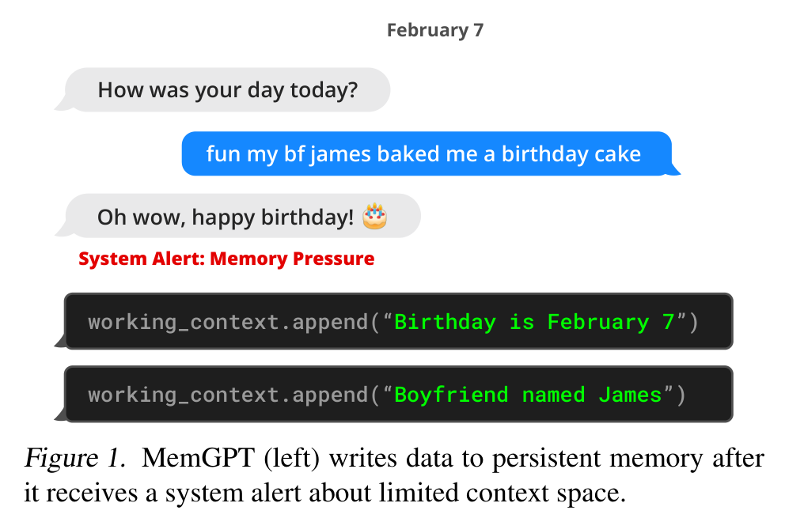
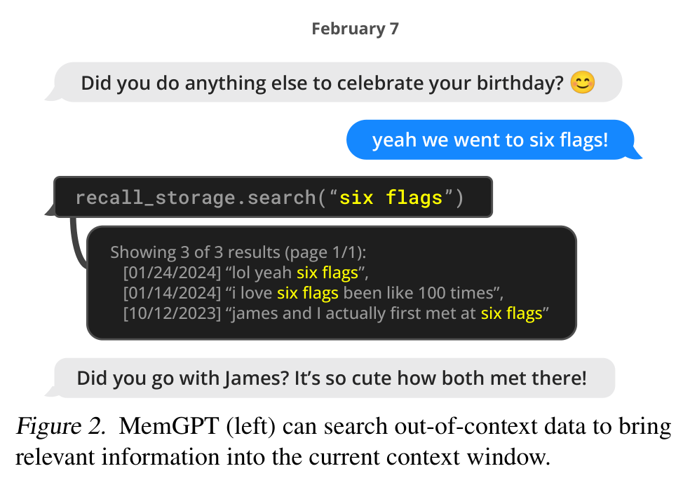
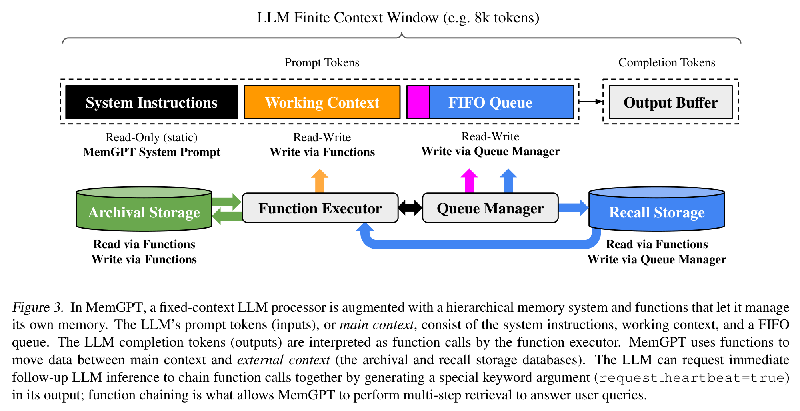
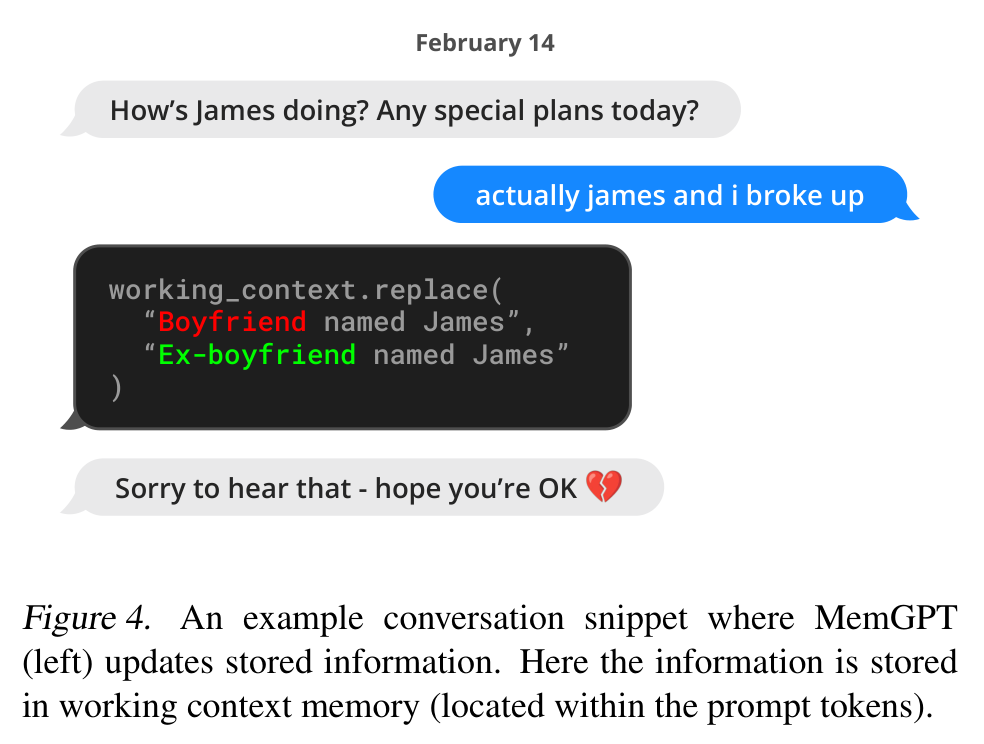
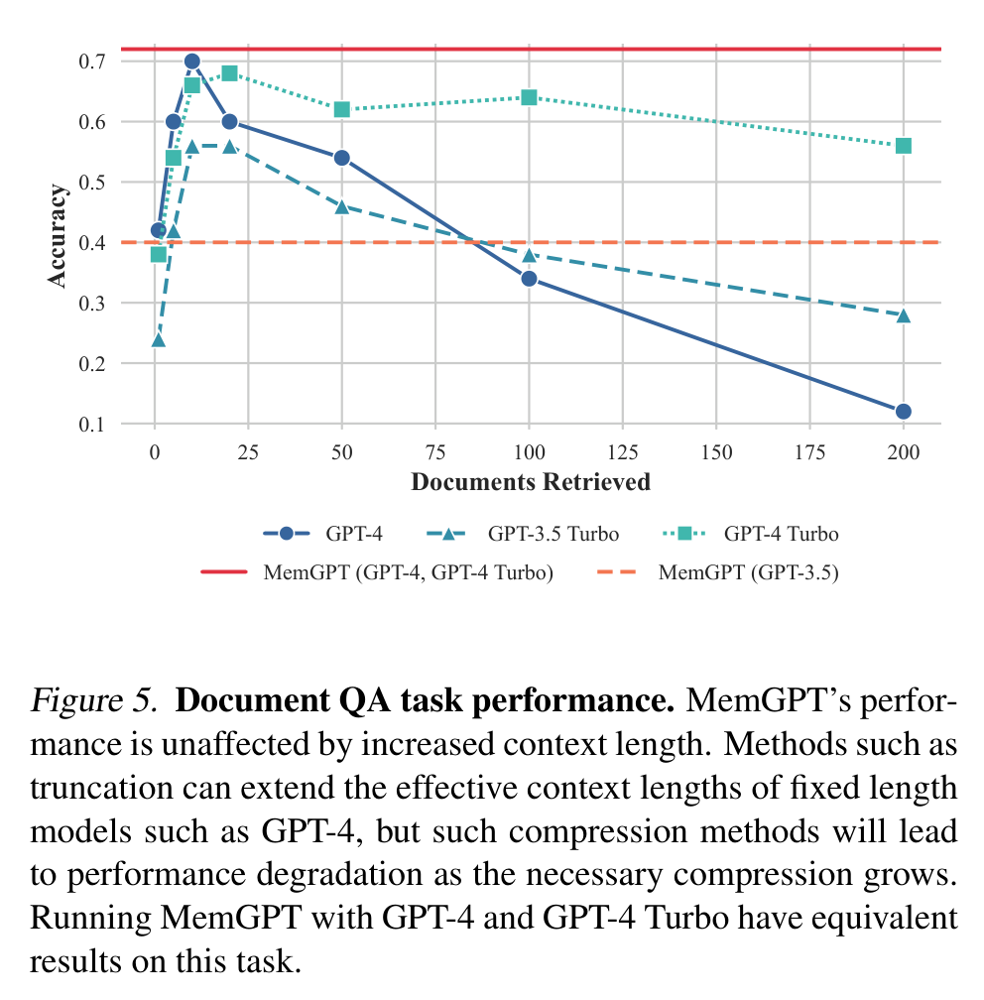
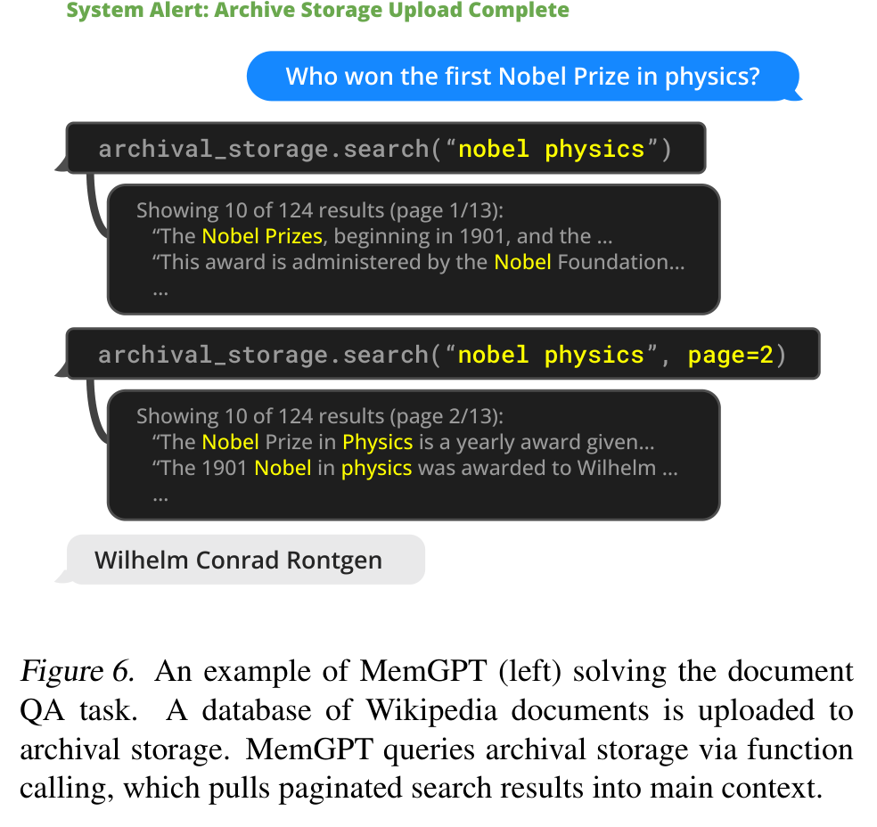
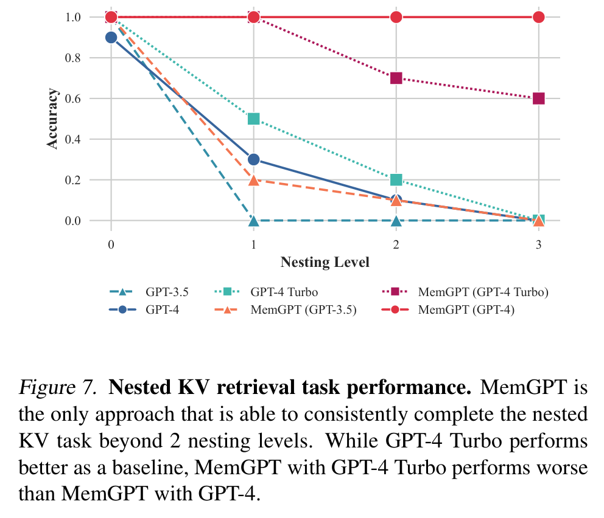
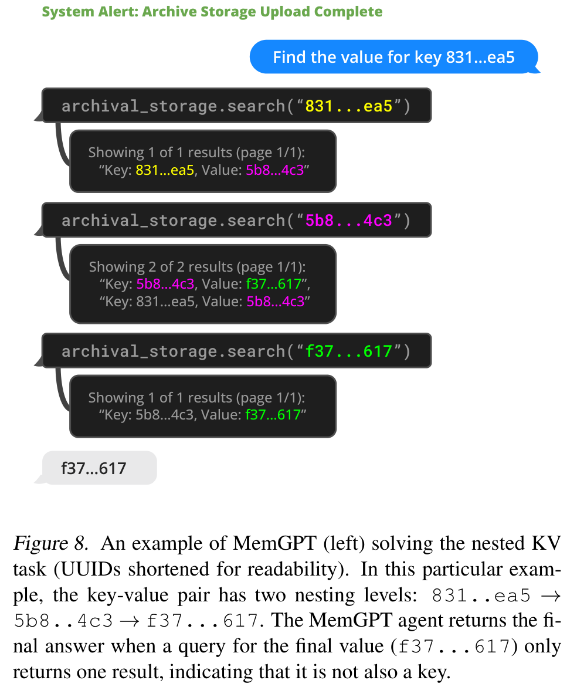

# 01 基础架构：MemGPT、Generative Agents、MemoryBank、CoALA

> 配套：[论文精读索引](README.md) · [学习路线](../../learning/agent-memory-tutorial/README.md)
> 这一卷建立四个基本直觉：记忆分层、检索打分、遗忘、统一术语。

---

## MemGPT: Towards LLMs as Operating Systems

**作者**：Charles Packer, Sarah Wooders, Kevin Lin, Vivian Fang, Shishir G. Patil, Ion Stoica, Joseph E. Gonzalez
**时间**：2023 首版；v2 2024-02（arXiv:2310.08560v2）
**一句话**：把 LLM 的有限上下文当成操作系统的“内存”，用分层存储、函数调用和中断机制扩展有效上下文。

> 图源：Packer et al., *MemGPT: Towards LLMs as Operating Systems*（CC BY 4.0）。以下图片按原论文图号裁剪，英文图注保留。

### 摘要（译文）

LLM 彻底改变了 AI，但受限于有限的上下文窗口，难以用于长对话、文档分析等任务。为了使用超出上下文窗口的信息，作者提出**虚拟上下文管理（virtual context management）**：借鉴传统操作系统的分层内存系统，通过在快内存和慢内存之间移动数据，营造出大内存的假象。基于此，作者提出 **MemGPT（Memory-GPT）**，智能管理不同记忆层级，在 LLM 有限的上下文窗口内提供扩展上下文，并使用中断管理自身与用户之间的控制流。作者在两个受上下文窗口严重限制的领域评估：文档分析（分析远超底层 LLM 窗口的大文档）和多会话聊天（创建能记住、反思并随长期交互动态演化的对话智能体）。

### 论文机制：一个 LLM 的“操作系统”

MemGPT 把上下文当“主内存”，把外部存储当“磁盘”。核心不是训练更长的模型，而是让 agent 自己分页。

论文图 1 和图 2 分别展示“写入记忆”和“检索记忆”两个动作：

论文图 3 是整体架构：主上下文由 System Instructions、Working Context 和 FIFO Queue 组成，外部由 Archival Storage 和 Recall Storage 组成，函数执行器与队列管理器负责二者之间的数据移动。

#### 主上下文（Main Context）

就是真正送进 LLM 的 prompt tokens，分三段：

1. **System Instructions**：只读系统提示，说明控制流、记忆层级、函数怎么用。
2. **Working Context**：固定大小的可读写文本块，存用户关键事实、偏好、agent 人设；只能通过函数修改。
3. **FIFO Queue**：滚动消息队列，包含用户消息、agent 回复、系统警告、函数输入/输出；队头通常放一条递归摘要，概括已被驱逐的消息。

任何不在主上下文里的信息，模型都看不见，必须通过函数调用“分页”进来。

#### 外部上下文（External Context）

- **Recall Storage**：消息数据库，保存完整对话历史，可搜索；
- **Archival Storage**：任意长文本/文档，通常带向量检索，可插入和搜索。

#### 队列管理器：内存压力、驱逐、递归摘要

- 新消息进来，追加到 FIFO，触发推理；用户消息和模型输出都写入 Recall Storage；
- prompt tokens 超过“警告阈值”（论文举例约 70% 窗口），插入 memory pressure 系统警告，提醒模型把重要信息写进 working context 或 archival storage；
- 超过“刷新阈值”（约 100%），驱逐约 50% 的消息，并用旧摘要 + 被驱逐消息生成新的递归摘要；
- 被驱逐的消息不会消失，仍在 Recall Storage，之后可以检索回来。

驱逐不是删除，只是移出上下文。

#### 函数执行器与控制流

LLM 输出先被解析成函数调用；执行结果（包括错误，如 working context 已满）反馈回模型。函数大致包括：

- 读写 working context（追加/替换）；
- 插入/搜索 archival storage；
- 搜索 recall storage；
- 向用户发送消息；
- 分页/翻页等辅助操作。

函数可以链式调用：模型可以连续执行多个函数再回复。函数支持“立即返回控制权”或“yield 等待下一个事件”。事件可以是用户消息、系统警告、用户登录、文档上传完成，或定时任务，所以 agent 可以“不被提示”地主动运行。

#### 一个具体例子

论文图 4 展示了 working context 的原地替换：用户透露分手后，MemGPT 把 `Boyfriend named James` 改成 `Ex-boyfriend named James`，后续回答因此使用更新后的事实。

- 2 月 7 日，working context 记着 “Boyfriend named James”；
- 2 月 14 日，用户说 “actually james and i broke up”；
- agent 调用 `working_context.replace("Boyfriend named James", "Ex-boyfriend named James")`；
- 之后问 “How's James doing?”，agent 用更新后的记忆回答。

另一个例子：用户问 “six flags”，agent 用 `recall_storage.search("six flags")` 从历史消息翻出相关对话，再拼回上下文。

### 实验与结论

论文评了两类任务：文档分析和多会话聊天。

**文档分析**：Document QA 与 nested KV retrieval（跨多个数据源拼信息）。结论：MemGPT 的性能不随文档变长而下降；截断/压缩上下文的基线会随压缩比例变大而退化。

论文图 5 是 Document QA 的性能曲线；图 6 是一个诺贝尔物理学奖问题的检索示例。图 7 是 nested KV 的性能曲线；图 8 展示了如何通过多轮 archival search 找到嵌套键值。

**多会话聊天**：在 Multi-Session Chat（MSC）上新增第 6 个会话做 Deep Memory Retrieval（DMR），问一个只有看过前 5 个会话才能答对的问题。

| 底层模型 | 不用 MemGPT（准确率 / ROUGE-L） | 用 MemGPT（准确率 / ROUGE-L） |
|---|---:|---:|
| GPT-3.5 Turbo | 38.7% / 0.394 | **66.9% / 0.629** |
| GPT-4 | 32.1% / 0.296 | **92.5% / 0.814** |
| GPT-4 Turbo | 35.3% / 0.359 | **93.4% / 0.827** |

另一个任务是 conversation opener：考 agent 能否用长期记忆写出个性化开场；论文称 MemGPT 在部分相似度指标上超过人类写的开场白。

关键观察：底层模型能力影响巨大。GPT-4 加持的 MemGPT 远好于 GPT-3.5，说明记忆管理不能替代模型本身的推理能力。

### 贡献与局限

**贡献**

- 提出“LLM OS / 虚拟上下文管理”的框架；
- 把记忆读写变成 agent 自主的函数调用，而不是外部硬编码；
- 用事件、内存压力、函数链、yield 组成一套控制流；
- 提出 DMR、nested KV retrieval 等评测任务；
- 直接启发了 Letta、Zep、MemOS、MemoryOS 等后续系统。

**局限**

- 函数和提示手工设计，分页策略依赖模型判断；
- 依赖 function calling 的可靠性，调错就丢信息；
- Recall/Archival 是平面存储，没有时间有效期、没有图关系；
- 递归摘要有损；
- 单个 agent、单个对话，缺少多会话共享、多 agent 协作；
- 评测规模有限，成本和延迟没有系统报告。

这些局限正是后来 Zep（时序图）、MemoryOS（分层记忆）、Memory-R1（学习记忆操作）、A-MEM（链接笔记）、MIRIX（多模态/多 agent）各自要解决的问题。

### 产品化：MemGPT → Letta

MemGPT 后来更名为 **Letta**。论文里的 MemGPT 是研究原型；今天的 Letta 是“有状态 agent”平台，当前活跃实现是 **Letta Code**；旧 `letta` 仓库保留的是已退役的 V1 API server。

#### 当前记忆模型：MemFS

Letta 现在主推 **MemFS**：一个 **git 版本化的记忆文件系统**。

- 记忆是 agent 状态的一部分，存在属于 agent 的 git 仓库里；
- MemFS 把仓库“投影”到 agent 运行的机器上，agent 用普通文件工具读写；
- 编辑在 commit + push 之后才成为“记忆”，有版本历史、冲突解决、已保存/未保存的边界；
- 记忆根目录的 `persona.md`、`human.md` 等文件每一轮都加载进 system prompt；
- 带自己 `MEMORY.md` 索引的子目录默认不进上下文，agent 看到文件树，需要时再读；
- 默认没有向量索引；关键词搜索可用，语义/混合搜索需要装 MemFS Search mod；
- 对话历史搜索是另一套：Cloud 支持全文/向量/混合，本地目前主要是全文。

可以把它理解为：早期 MemGPT/Letta 的 memory blocks，现在由 MemFS 根目录的常驻文件承担；更深的记忆放在子目录里按需读取。

#### Dreaming（后台整理）

Dreaming 用后台 subagent 回顾最近对话，把有用的经验整合进记忆，不打断主任务。

- 触发方式：每 N 个 agent step，或上下文被压缩时；
- 行为：只提醒，或自动启动；
- 可以让 agent 在第二段后台对话里先审查再应用；
- CLI 里有 `/init`、`/remember`、`/memory`、`/doctor`、`/sleeptime`；
- `/doctor` 审计记忆的放置、重复和 system prompt 的 token 占用。

这是把论文里的“递归摘要 + 自我编辑”升级成“git 版本化 + 后台反思”。

#### 多会话、多 agent、部署

- **Conversations**：一个 agent 可以有多个独立对话线程，共享同一份记忆；
- **Shared memory repositories**：多个 agent 可以共享同一个记忆仓库（Cloud 功能；自托管可以用自己的 git remote）；
- **Letta Code**：CLI、Web、Desktop、SDK，支持 Slack/Telegram/Discord/WhatsApp/Signal 等渠道，可以在多台电脑之间迁移；
- **Cloud vs local**：Cloud 会备份 agent 的记忆、身份和对话；local-only agent 只存在本机，需要自己备份；
- **配额**：Cloud 免费版每个记忆仓库 5 MiB，Pro 50 MiB（按分支/标签最新快照计，不算 git 历史）。

#### 论文 vs 当前产品

| 维度 | MemGPT 论文（2023） | Letta / Letta Code（2026） |
|---|---|---|
| 主上下文 | System + Working Context + FIFO Queue | System prompt + MemFS 根目录常驻文件 |
| 外部记忆 | Recall Storage（消息库）+ Archival Storage（向量库） | MemFS git 仓库（Markdown 文件 + 目录索引） |
| 写入方式 | LLM 函数调用读写记忆 | agent 用文件工具编辑 + commit/push |
| 溢出处理 | 内存压力警告、驱逐、递归摘要 | 上下文压缩 + 多会话 + dreaming 整理 |
| 检索 | recall/archival 函数搜索 | 文件搜索；可选语义/混合搜索；对话搜索单独 |
| 作用域 | 单 agent、单对话 | 多对话共享记忆；多 agent 可共享仓库 |
| 版本 | 无 | git 版本历史、冲突解决、worktree |
| 产品形态 | 研究原型 + 代码 | CLI / Web / Desktop / SDK / Cloud |

**没变的东西**：上下文是稀缺资源；agent 自己决定记什么；记忆要能编辑、能检索、能跨会话；OS 的“分页”隐喻仍然成立。

**变了的东西**：从“数据库 + 函数调用”变成“git 文件 + 文件工具”；从“递归摘要”变成“多会话 + dreaming”；从“单 agent”变成“多 agent 共享记忆”；从“研究代码”变成“可部署产品”。

### Letta 是完整 harness 吗？与其它 harness 的关系

是。**Letta Code 是一个完整的 agent harness，不是只做记忆的库。**

它包含：agent loop、上下文管理、工具执行、权限、子代理、调度、渠道（Slack/Telegram/Discord 等）、模型提供方、MemFS 记忆、skills、mods（它甚至能改自己的 harness）、CLI/App Server/Agent SDK。README 的原话是 “a full agent harness, not a chat wrapper”.

“harness” 有两个语境，别混：

- **agent harness**：围绕模型的脚手架（prompt、工具、循环、上下文、权限、环境）。Letta Code 属于这一类。
- **evaluation harness**：跑 benchmark 的 runner/scorer。那是另一回事，Letta 不是评测框架。

和其它东西的关系：

| 对比对象 | 关系 |
|---|---|
| 编码 agent harness（Claude Code、Codex CLI、Cursor、OpenCode） | 同一层：都是“模型 + 工具 + 循环 + 上下文管理”的 harness。Letta Code 的差异是开源、模型无关、记忆优先、可多机/多渠道/可嵌入。 |
| 编排框架（LangGraph、LangChain） | 不同层：LangGraph 提供图/状态编排库，你自己搭循环；Letta 是开箱即用的运行时。可以用 Agent SDK/App Server 把 Letta 当 agent 后端。 |
| 记忆层（Mem0、Zep/Graphiti、MemOS） | 记忆层只解决“存/取/更新”；Letta 既跑 loop 又内置 MemFS 记忆。只缺记忆时，用轻量记忆层即可。 |
| Agent SDK/框架（OpenAI Agents SDK、Google ADK、CrewAI） | Letta 提供持久化 agent runtime + SDK；不是只给一组抽象。可通过 MCP/ACP 与外部客户端/agent 协作。 |
| MCP | Letta 既能使用外部 MCP 工具，也能通过 Cloud 的 Hosted MCP 让别的 agent 创建/调用 Letta agent。 |
| ACP | 编辑器/客户端通过 ACP 驱动 Letta agent；每个 ACP session 是一个 conversation，记忆继续保留。 |

一句话：**Letta 既是 harness，也可以是“被别的 harness 调用的有状态 agent 后端”**。如果只缺记忆，它偏重；如果要一个能长期运行、带记忆和工具循环的 agent，它就是完整方案。

### 为什么读

它是 Letta（原 MemGPT）的思想源头，也是“把记忆当成 OS 资源管理”的最经典类比。读完它，你会更容易理解后来所有“主上下文 + 外部存储 + 检索”的架构。

### 与教程对应

[00 定位与概念](../../learning/agent-memory-tutorial/00-orientation.md) · [01 边界](../../learning/agent-memory-tutorial/01-boundaries.md) · [03 存储](../../learning/agent-memory-tutorial/03-storage.md)

---

## Generative Agents: Interactive Simulacra of Human Behavior

**作者**：Joon Sung Park, Joseph C. O'Brien, Carrie J. Cai, Meredith Ringel Morris, Percy Liang, Michael S. Bernstein
**时间**：2023（arXiv:2304.03442v2）
**一句话**：用“记忆流 + 检索打分 + 反思 + 规划”让 25 个 agent 在沙盒里表现出可信的长期行为。

### 摘要（译文）

可信的人类行为代理可以支持沉浸式环境、人际沟通排练和原型设计等应用。本文提出**生成式智能体（generative agents）**：模拟可信人类行为的计算软件智能体。它们会起床、做早餐、上班；艺术家画画，作家写作；它们形成观点、注意彼此、发起对话；它们记住并反思过去的日子，同时规划下一天。为实现这一点，作者描述了一种架构：扩展 LLM，用自然语言存储智能体经历的完整记录，随时间把记忆综合成更高层的反思，并动态检索以规划行为。作者在一个受《模拟人生》启发的交互式沙盒中实例化 25 个智能体，用户可以用自然语言与小镇交互。评估显示，这些智能体产生了可信的个体和涌现社会行为：例如，仅给一个 agent“想办情人节派对”的初始想法，接下来两天里 agent 们会自主传播邀请、结识新朋友、互相邀约、协调时间一起出现。消融实验表明，观察、规划和反思三个组件都对行为可信度有重要贡献。

### 核心设计

- **记忆流（memory stream）**：用自然语言完整记录 agent 的经历，而不是只存摘要。
- **检索打分**：候选记忆按三个信号排序——新近度（recency）、重要性（importance）、相关性（relevance，通常用 embedding）。
- **反思（reflection）**：定期把零散记忆综合成更高层的洞察（例如“我喜欢滑雪”），再写回记忆。
- **规划（planning）**：把高层目标分解成日常行动，并根据观察动态调整。

### 实验与结论

25 个 agent 的沙盒实验；情人节派对从单个想法涌现为多人协调行为；消融显示 observation、planning、reflection 各自关键。

### 局限

- 沙盒规模小，行为“可信”不等于事实正确；
- 大量 LLM 调用，成本和延迟高；
- 记忆检索打分是启发式的，缺少大规模定量评测。

### 为什么读

它是“记忆流 + 多信号检索 + 反思”的教科书式实现，后来很多 agent memory 系统都借用这套结构。读它重点看检索打分和反思，而不是沙盒本身。

### 与教程对应

[02 写入](../../learning/agent-memory-tutorial/02-writing.md) · [04 召回](../../learning/agent-memory-tutorial/04-retrieval.md) · [05 融合与选择](../../learning/agent-memory-tutorial/05-fusion.md)

---

## MemoryBank: Enhancing Large Language Models with Long-Term Memory

**作者**：Wanjun Zhong, Lianghong Guo, Qiqi Gao, He Ye, Yanlin Wang
**时间**：2023（arXiv:2305.10250v3）
**一句话**：给 LLM 加一套带“遗忘曲线”的长期记忆，让它能记住用户、随时间更新，并在陪伴场景中表现得更像人。

### 摘要（译文）

LLM 的进步重塑了人机交互，但仍缺少长期记忆机制；在个人陪伴、心理咨询等需要持续交互的场景中，这一缺陷尤其明显。作者提出 **MemoryBank**：一种为 LLM 设计的记忆机制，让模型能唤起相关记忆、通过持续更新演化、综合过去交互来理解并适应用户人格。为了模拟拟人化的选择性记忆，MemoryBank 引入受艾宾浩斯遗忘曲线启发的记忆更新机制：根据时间流逝和记忆的相对重要性，允许 AI 遗忘或强化记忆。MemoryBank 可适配 ChatGPT 等闭源模型和 ChatGLM 等开源模型。作者用长期 AI 陪伴场景中的聊天机器人 **SiliconFriend** 展示应用；用心理对话微调后，SiliconFriend 表现出更高的共情。实验包括真实用户对话的定性分析和模拟对话的定量分析；在模拟中，ChatGPT 扮演不同特征的用户，生成覆盖广泛主题的长期对话。结果显示，配备 MemoryBank 的 SiliconFriend 能提供共情回应、回忆相关记忆并理解用户人格。

### 核心设计

- **记忆存储与检索**：保存用户交互，按相关性召回；
- **记忆更新**：不是所有记忆永久等权，时间越久越容易衰减；被反复使用或重要的记忆会被强化；
- **用户画像**：从长期交互中综合用户特征，影响后续回复；
- **SiliconFriend**：陪伴型聊天机器人，支持闭源/开源模型。

### 实验与结论

真实用户对话的定性分析 + 模拟长期对话的定量分析；结论是长期陪伴能力（共情、回忆、人格理解）提升。

### 局限

- 陪伴/心理咨询是特定领域，通用性未验证；
- 遗忘曲线是启发式，不是学出来的；
- 评测偏主观，缺少大规模可复现的公开 benchmark。

### 为什么读

如果你要设计“记忆过期/遗忘/TTL”，这是最早把时间衰减写进记忆系统的论文之一。它提醒你：记忆不是越多越好，保留和遗忘都是设计。

### 与教程对应

[06 更新与治理](../../learning/agent-memory-tutorial/06-governance.md)

---

## CoALA: Cognitive Architectures for Language Agents

**作者**：Theodore R. Sumers, Shunyu Yao, Karthik Narasimhan, Thomas L. Griffiths
**时间**：2023（TMLR 02/2024；arXiv:2309.02427v3）
**一句话**：用“记忆模块 + 动作空间 + 决策循环”三个维度统一描述语言智能体。

### 摘要（译文）

语言智能体用 LLM 与内部记忆和外部环境交互。本文借鉴认知科学和符号 AI，提出 **CoALA**：模块化记忆（工作记忆 + 情景/语义/程序长期记忆）、结构化动作空间（内部：检索、推理、学习；外部：落地）和通用决策过程（规划 + 执行循环）。CoALA 可以回顾性组织大量现有工作，并前瞻性指出新方向。

### 为什么读

它是本套教程的术语基础。读完你应该能回答：这个系统的记忆单元是什么？动作空间有哪些？决策是单步还是提议-评估-选择？

### 全文翻译

[CoALA 中文全文](../coala-zh.md)

---

## 本卷小结

| 论文 | 给你什么 | 最关键的一页 |
|---|---|---|
| MemGPT | 记忆分层与分页 | 主上下文 vs 外部上下文 |
| Generative Agents | 检索打分与反思 | memory stream + recency/importance/relevance |
| MemoryBank | 遗忘与时间衰减 | 艾宾浩斯遗忘曲线 |
| CoALA | 统一术语 | 记忆、动作、决策三轴 |

下一步：[02 综述](02-surveys.md)。